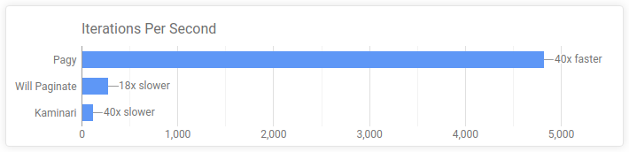
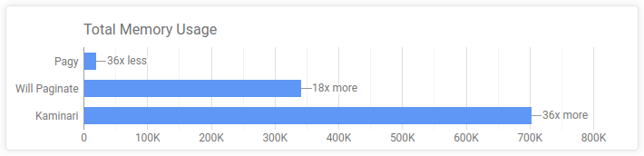
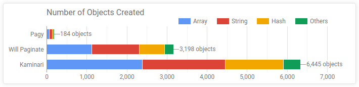
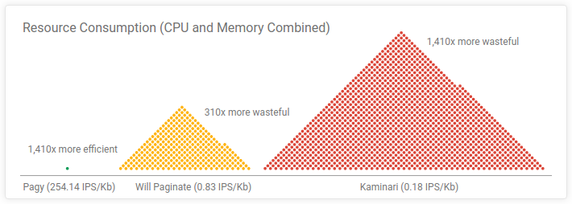
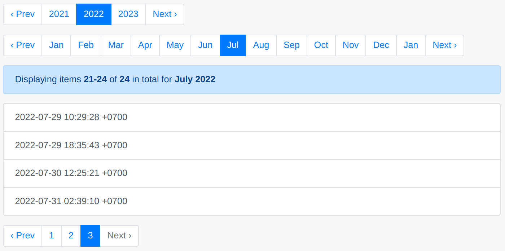
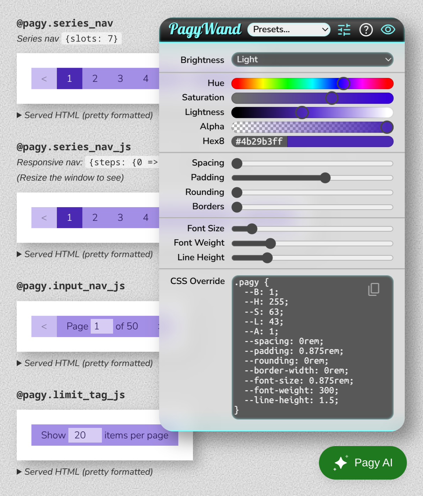
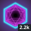
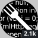

<span>[](https://rubygems.org/gems/pagy)</span> <span>
[](https://endoflife.date/ruby)</span> <span>
[](https://github.com/ddnexus/pagy/actions/workflows/api-test.yml)</span> <span>
[](https://github.com/ddnexus/pagy/actions/workflows/e2e-test.yml)</span> <span>
</span> <span>
</span> <span>
[](http://opensource.org/licenses/MIT)</span> <span>
[](https://github.com/ddnexus/pagy/commits/master/)</span> <span>
[](https://rubygems.org/gems/pagy)</span> <span>
[](https://github.com/ddnexus/pagy/stargazers)</span> <span>
[](https://gurubase.io/g/pagy)</span>

#

<h2><br/>Pagy the leaping gem!</h2>

_Agnostic pagination in plain Ruby_

<br/>

> [!TIP]
> ⭐ If you like Pagy, please support it with a Star! ⭐

<br/>

<!-- whats_new_start -->

### Version 43

We needed a leap version to unequivocally signal that it's not just a major version: it's a complete redesign of the legacy code at all levels, usage and API included.

**Why 43?** Because it's exactly one step beyond _"The answer to the ultimate question of life, the Universe, and everything."_ 😉

#### Improvements

This version introduces several enhancements, such as new `:countish` and `:keynav_js` paginators and improved automation and configuration processes, reducing setup requirements by 99%. The update also includes a simpler API and new interactive development tools, making it a comprehensive upgrade from previous versions.

- **New [:countish](https://ddnexus.github.io/pagy/toolbox/paginators/countish) Paginator**
  - Faster than OFFSET and supporting the full UI
- **New [Keynav](https://ddnexus.github.io/pagy/toolbox/paginators/keynav_js) Pagination**
  - The pagy-exclusive technique using the fastest [keyset](https://ddnexus.github.io/pagy/toolbox/paginators/keyset) pagination alongside all frontend helpers.
- **New interactive dev-tools**
  - New [PagyWand](https://ddnexus.github.io/pagy/resources/stylesheets/#pagy-wand) to integrate the pagy CSS with your app themes.
  - New **Pagy AI** available right inside your own app.
- **Intelligent automation**
  - [Configuration](https://ddnexus.github.io/pagy/toolbox/configuration/initializer) requirements reduced by 99%.
  - Simplified [JavaScript](https://ddnexus.github.io/pagy/resources/javascript) setup.
  - Automatic [I18n](https://ddnexus.github.io/pagy/resources/i18n) loading.
- **[Simpler API](https://github.com/ddnexus/pagy#examples)**
  - You solely need the [pagy](https://ddnexus.github.io/pagy/toolbox/paginators) method and the [@pagy](https://ddnexus.github.io/pagy/toolbox/helpers) instance to paginate any collection and use any navigation tag and helper.
  - Methods are autoloaded only if used, and consume no memory otherwise.
  - Methods have narrower scopes and can be [overridden](https://ddnexus.github.io/pagy/guides/how-to#override-pagy-methods) without deep knowledge.
- **New [documentation](https://ddnexus.github.io/pagy/guides/quick-start)**
  - Very concise, straightforward, and easy to navigate and understand.

### Upgrade to 43

See the [Upgrade Guide](https://ddnexus.github.io/pagy/guides/upgrade-guide/)

<!-- whats_new_end -->

Take a look at the [Examples](#-examples) for a quick overview of the new API.

<br/>

### <span style="font-size: .65em; vertical-align: middle">💚</span> v3 was already quite snappy...

[](https://ddnexus.github.io/pagination-comparison/gems.html#ips-benchmark)<br>
[](https://ddnexus.github.io/pagination-comparison/gems.html#memory-profile)<br>
[](https://ddnexus.github.io/pagination-comparison/gems.html#memory-profile)<br>
[](https://ddnexus.github.io/pagination-comparison/gems.html#efficiency-ratio)

<br/>

### ... and now it's more, with less.

- Compatible with all environments and collection types
- It can use OFFSET, COUNTISH, COUNTLESS, KEYSET, KEYNAV, SEARCH, and CALENDAR pagination techniques
- It supports server-side rendering or faster client-side rendering for popular CSS frameworks and APIs
- It autoloads ONLY the methods that you actually use, with almost zero configuration
- It boasts 100% test coverage for Ruby, HTML, and JavaScript end-to-end (E2E)

<br/>

> [!TIP]
> ⭐ If you like Pagy, please support it with a Star! ⭐

<br/>

### <span style="font-size: .65em; vertical-align: middle">💚</span> Examples

##### Pagination code

```rb
# Include pagy in your code (usually application_controller.rb)
include Pagy::Method

# Offset-based pagination
@pagy, @records = pagy(:offset, Product.all)

# Keyset-based pagination (fastest technique)
@pagy, @records = pagy(:keyset, Product.order(my_order).all)

# Paginate your collection with one of several paginators
@pagy, @records = pagy(...)
```

_See all the available [paginators](https://ddnexus.github.io/pagy/toolbox/paginators/#paginators)_

##### JSON:API pagination

```ruby
# JSON:API nested query string. E.g.: ?page[number]=2&page[size]=100
@pagy, @records = pagy(:offset, Product.all, jsonapi: true)
@pagy, @records = pagy(:keyset, Product.order(my_order).all, jsonapi: true)
render json: { links: @pagy.urls_hash, data: @records }
```

##### JSON-client pagination

```ruby
render json: { pagy: @pagy.data_hash, data: @records }
```

##### Search server pagination

Available paginators: `:elasticsearch_rails`, `:meilisearch`, `:rails_active_search`, `:searchkick`, `:typesense_rails`

```rb
# Extend your models (e.g. application_record.rb)
extend Pagy::Search

# Paginate with pagy:
search           = Product.pagy_search(params[:q])
@pagy, @response = pagy(:a_search_paginator, search)

# Or get pagy from paginated results:
@results = Product.search(params[:q])
@pagy    = pagy(:a_search_paginator, @results)
```

##### Calendar pagination

Combine `time-range` and `offset` pagination.

_(Available time units: year, quarter, month, week, and day)_

<br/>

```ruby
@calendar, @pagy, @records = pagy(:calendar, collection, year: {}, month: {}, offset: {})
```

```ERB
<%== @calendar[:year].series_nav(:bootstrap) %>
<%== @calendar[:month].series_nav(:bootstrap) %>
<%== @pagy.info_tag %>
...
<%== @pagy.series_nav(:bootstrap) %>
```

##### Server side rendering

##### `series_nav`

Default `:pagy`, `:bootstrap` and `:bulma` styles shown.

<br/>
<br/>
<br/>

```erb
<!-- Render server side nav bar helpers with different html and styles -->
<%== @pagy.series_nav %> <!-- pagy style -->
<%== @pagy.series_nav(:bootstrap) %>
<%== @pagy.series_nav(:bulma) %>
```

##### Client side rendering

```rb
# pagy.rb initializer
javascript_dir = Rails.root.join('app/javascript')
Pagy.sync_javascript(javascript_dir, 'pagy.mjs') if Rails.env.development?
```

##### `series_nav_js`

**Faster and responsive**

Dynamically fills the container width.

<br/>
<br/>

```erb
<!-- Render client side nav bar helpers with different html and styles -->
<%== @pagy.series_nav_js %> <!-- pagy style -->
<%== @pagy.series_nav_js(:bootstrap) %>
<%== @pagy.series_nav_js(:bulma) %>
```

##### `input_nav_js`

**Fastest!** Combines navigation and info in minimum space.

<br/>

```erb
<!-- Render client side nav input helpers with different html and styles -->
<%== @pagy.input_nav_js %> <!-- pagy style -->
<%== @pagy.input_nav_js(:bootstrap) %>
<%== @pagy.input_nav_js(:bulma) %>
```

<br/>

### <span style="font-size: .65em; vertical-align: middle">💚</span> Dev Tools

Integrate pagy with your app's themes interactively ([watch demo](https://youtu.be/GhhNRrVG9jg)), and ask specific questions to the Pagy AI __right in your app__! You need only a single line in your page/layout `head` to get the Pagy Wand and the Pagy AI:

```erb
<%== Pagy.dev_tools %>
```

<br/>

See [Dev Tools](https://ddnexus.github.io/pagy/sandbox/dev_tools/)

<br/>

### <span style="font-size: .65em; vertical-align: middle">💚</span> Support and Docs

- [Quick Start](https://ddnexus.github.io/pagy/guides/quick-start)
- [How To (quick recipes)](https://ddnexus.github.io/pagy/guides/how-to/)
- [Migrate from WillPaginate and Kaminari](https://ddnexus.github.io/pagy/guides/migration-guide) (practical guide)
- [Discussions](https://github.com/ddnexus/pagy/discussions/categories/q-a)
- [Issues](https://github.com/ddnexus/pagy/issues)
- [Changelog](https://ddnexus.github.io/pagy/changelog)

<br/>

> [!TIP]
> ⭐ If you like Pagy, please support it with a Star! ⭐

<br/>

### Top 🏆 Adopters

<!-- top_adopters_start -->

[](https://github.com/docusealco/docuseal)[](https://github.com/opf/openproject)[](https://github.com/spree/spree)[](https://github.com/Freika/dawarich)[](https://github.com/we-promise/sure)[](https://github.com/antiwork/gumroad)[](https://github.com/TheOdinProject/theodinproject)[](https://github.com/octobox/octobox)[](https://github.com/blackcandy-org/blackcandy)[](https://github.com/pglombardo/PasswordPusher)[](https://github.com/CanineHQ/canine)[](https://github.com/rubygems/rubygems.org)[](https://github.com/otwcode/otwarchive)[](https://github.com/manyfold3d/manyfold)[](https://github.com/greasyfork-org/greasyfork)[](https://github.com/openjournals/joss)[](https://github.com/bullet-train-co/bullet_train)[](https://github.com/avo-hq/avo)[](https://github.com/ossf/best-practices-badge)[](https://github.com/Shopify/maintenance_tasks)[](https://github.com/openfoodfoundation/openfoodnetwork)[](https://github.com/CircuitVerse/CircuitVerse)[](https://github.com/inertiajs/inertia-rails)[](https://github.com/drhenner/ror_ecommerce)[](https://github.com/TarteelAI/quranic-universal-library)

…and [13,500+ more public repos](https://github.com/ddnexus/pagy/network/dependents) on GitHub.

<!-- top_adopters_end -->

<br/>

### Top 💯 Contributors

<!-- top100_start -->

[](https://github.com/ddnexus/pagy/commits?author=ddnexus)[](https://github.com/ddnexus/pagy/commits?author=benkoshy)[](https://github.com/ddnexus/pagy/commits?author=grosser)[](https://github.com/ddnexus/pagy/commits?author=sunny)[](https://github.com/ddnexus/pagy/commits?author=djpremier)[](https://github.com/ddnexus/pagy/commits?author=enzinia)[](https://github.com/ddnexus/pagy/commits?author=molfar)[](https://github.com/ddnexus/pagy/commits?author=lfidnl)[](https://github.com/ddnexus/pagy/commits?author=workgena)[](https://github.com/ddnexus/pagy/commits?author=renshuki)[](https://github.com/ddnexus/pagy/commits?author=7a6163)[](https://github.com/ddnexus/pagy/commits?author=yshmarov)[](https://github.com/ddnexus/pagy/commits?author=daniel-rikowski)[](https://github.com/ddnexus/pagy/commits?author=berniechiu)[](https://github.com/ddnexus/pagy/commits?author=bquorning)[](https://github.com/ddnexus/pagy/commits?author=rbngzlv)[](https://github.com/ddnexus/pagy/commits?author=lumikcz)[](https://github.com/ddnexus/pagy/commits?author=747)[](https://github.com/ddnexus/pagy/commits?author=bruno-costanzo)[](https://github.com/ddnexus/pagy/commits?author=ShyamBorsaniya)[](https://github.com/ddnexus/pagy/commits?author=kelso)[](https://github.com/ddnexus/pagy/commits?author=Davidzhu001)[](https://github.com/ddnexus/pagy/commits?author=jeffse)[](https://github.com/ddnexus/pagy/commits?author=ikanade)[](https://github.com/ddnexus/pagy/commits?author=tersor)[](https://github.com/ddnexus/pagy/commits?author=tiagotex)[](https://github.com/ddnexus/pagy/commits?author=kobusjoubert)[](https://github.com/ddnexus/pagy/commits?author=sabljak)[](https://github.com/ddnexus/pagy/commits?author=tagliala)[](https://github.com/ddnexus/pagy/commits?author=espen)[](https://github.com/ddnexus/pagy/commits?author=jyuvaraj03)[](https://github.com/ddnexus/pagy/commits?author=LuukvH)[](https://github.com/ddnexus/pagy/commits?author=thomasklemm)[](https://github.com/ddnexus/pagy/commits?author=simonneutert)[](https://github.com/ddnexus/pagy/commits?author=sk8higher)[](https://github.com/ddnexus/pagy/commits?author=petergoldstein)[](https://github.com/ddnexus/pagy/commits?author=AbelToy)[](https://github.com/ddnexus/pagy/commits?author=yhk1038)[](https://github.com/ddnexus/pagy/commits?author=MrMoins)[](https://github.com/ddnexus/pagy/commits?author=YutoYasunaga)[](https://github.com/ddnexus/pagy/commits?author=cseelus)[](https://github.com/ddnexus/pagy/commits?author=jivko-chobanov)[](https://github.com/ddnexus/pagy/commits?author=benjaminwols)[](https://github.com/ddnexus/pagy/commits?author=cellvinchung)[](https://github.com/ddnexus/pagy/commits?author=jonasCyberdude)[](https://github.com/ddnexus/pagy/commits?author=thattimc)[](https://github.com/ddnexus/pagy/commits?author=glenbray)[](https://github.com/ddnexus/pagy/commits?author=muhammadnawzad)[](https://github.com/ddnexus/pagy/commits?author=thomaschauffour)[](https://github.com/ddnexus/pagy/commits?author=KinWang-2013)[](https://github.com/ddnexus/pagy/commits?author=t0ch1k)[](https://github.com/ddnexus/pagy/commits?author=Cosmo)[](https://github.com/ddnexus/pagy/commits?author=Earlopain)[](https://github.com/ddnexus/pagy/commits?author=yenshirak)[](https://github.com/ddnexus/pagy/commits?author=leonvogt)[](https://github.com/ddnexus/pagy/commits?author=borama)[](https://github.com/ddnexus/pagy/commits?author=leoplct)[](https://github.com/ddnexus/pagy/commits?author=kursataktas)[](https://github.com/ddnexus/pagy/commits?author=geoffreymcgill)[](https://github.com/ddnexus/pagy/commits?author=wimdavies)[](https://github.com/ddnexus/pagy/commits?author=andycroll)[](https://github.com/ddnexus/pagy/commits?author=mikepayready)[](https://github.com/ddnexus/pagy/commits?author=gamafranco)[](https://github.com/ddnexus/pagy/commits?author=excid3)[](https://github.com/ddnexus/pagy/commits?author=rogermarlow)[](https://github.com/ddnexus/pagy/commits?author=JasonBarnabe)[](https://github.com/ddnexus/pagy/commits?author=ethancrawford)[](https://github.com/ddnexus/pagy/commits?author=rafaeelaudibert)[](https://github.com/ddnexus/pagy/commits?author=claudiob)[](https://github.com/ddnexus/pagy/commits?author=rainerborene)[](https://github.com/ddnexus/pagy/commits?author=achmiral)[](https://github.com/ddnexus/pagy/commits?author=branson-simplethread)[](https://github.com/ddnexus/pagy/commits?author=jonathanloos)[](https://github.com/ddnexus/pagy/commits?author=thedanbob)[](https://github.com/ddnexus/pagy/commits?author=lostapathy)[](https://github.com/ddnexus/pagy/commits?author=connie-feng)[](https://github.com/ddnexus/pagy/commits?author=ranvold)[](https://github.com/ddnexus/pagy/commits?author=ashmaroli)[](https://github.com/ddnexus/pagy/commits?author=rhodes-david)[](https://github.com/ddnexus/pagy/commits?author=smoothdvd)[](https://github.com/ddnexus/pagy/commits?author=okuramasafumi)[](https://github.com/ddnexus/pagy/commits?author=tr4b4nt)[](https://github.com/ddnexus/pagy/commits?author=Atul9)[](https://github.com/ddnexus/pagy/commits?author=AngelGuerra)[](https://github.com/ddnexus/pagy/commits?author=gjtorikian)[](https://github.com/ddnexus/pagy/commits?author=olieidel)[](https://github.com/ddnexus/pagy/commits?author=pranavbabu)[](https://github.com/ddnexus/pagy/commits?author=PedroAugustoRamalhoDuarte)[](https://github.com/ddnexus/pagy/commits?author=peter50216)[](https://github.com/ddnexus/pagy/commits?author=RyanTG)[](https://github.com/ddnexus/pagy/commits?author=jgarber623)[](https://github.com/ddnexus/pagy/commits?author=KieraninTehdas)[](https://github.com/ddnexus/pagy/commits?author=mcauser)[](https://github.com/ddnexus/pagy/commits?author=fkmy)[](https://github.com/ddnexus/pagy/commits?author=denny)[](https://github.com/ddnexus/pagy/commits?author=creativetags)[](https://github.com/ddnexus/pagy/commits?author=rafaelmontas)[](https://github.com/ddnexus/pagy/commits?author=AliOsm)[](https://github.com/ddnexus/pagy/commits?author=PyrinAndrii)
<!-- top100_end -->

<br/>

### <span style="font-size: .65em; vertical-align: middle">💚</span> Credits

Special thanks to:

- [JetBrains](http://www.jetbrains.com?from=https%3A%2F%2Fgithub.com%2Fddnexus%2Fpagy) for their free open source license.
- [Ben Koshy](https://github.com/benkoshy) for his contributions to the documentation, user support and interaction with external frameworks.
- [The Stargazers](https://github.com/ddnexus/pagy/stargazers) for their support.

<br/>

### <span style="font-size: .65em; vertical-align: middle">💚</span> Repository Info

<details>

<summary>How to contribute</summary>

See [Contributing](https://github.com/ddnexus/pagy/blob/master/.github/CONTRIBUTING.md)

</details>

<details>

<summary>Versioning</summary>

- Pagy follows the [Semantic Versioning 2.0.0](https://semver.org/). Please check the [Changelog](https://ddnexus.github.io/pagy/changelog) for breaking changes introduced by major versions. Using [pessimistic version constraint](https://guides.rubygems.org/patterns/#pessimistic-version-constraint) in your Gemfile will ensure smooth upgrades.

</details>

<details>

<summary>Branches</summary>

- The `master` branch is the latest rubygem-published release. It also contains docs and comment changes that don't affect the published code. It is never force-pushed.
- The `dev` branch is the development branch with the new code that will be merged in the next release. It could be force-pushed.
- Expect any other branch to be internal, experimental, force-pushed, rebased and/or deleted even without merging.

</details>

<br/>

### <span style="font-size: .65em; vertical-align: middle">💚</span> License

[MIT](https://opensource.org/licenses/MIT)
